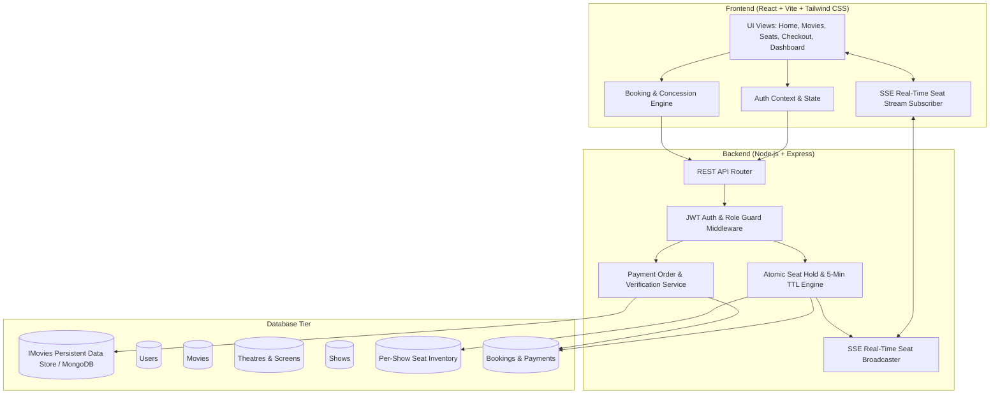

# IMovies — Full-Stack Cinema Ticket Booking & Management System

An enterprise-grade, modern cinema ticket booking web application built with a React frontend, Node.js and Express backend, persistent document store (with full Mongoose MongoDB models), JWT authentication, real-time seat synchronization, and an administrative operations dashboard.

---

## 🌟 Key Features

### 🎬 Customer Experience
- **Cinematic Discovery**: Featured blockbuster hero banners with HD video trailer modal previews, Now Showing and Coming Soon carousels, genre filters, and text search across titles, directors, and actors.
- **Location & Multiplex Selection**: Filter scheduled shows across major cinema hubs (Mumbai, Delhi NCR, Bengaluru, New York) with format tags (IMAX Laser 4K, Dolby Atmos, 4DX, VIP Recliner Lounge).
- **Real-Time Interactive Seat Selection**:
  - Live seat matrices categorized into **Classic Standard**, **Prime Center Stage**, and **VIP Recliner Lounge**.
  - Server-Sent Events (SSE) broadcast: Seat reservations in one tab/browser update in real-time across all connected clients without page reloads.
  - **5-Minute Atomic Holds**: Seats are locked atomically on the backend with an active countdown timer. Stale holds auto-expire after 300 seconds to prevent double-booking.
- **Concessions & Add-Ons**: Pre-order movie snacks (Jumbo Caramel & Butter Popcorn, Loaded Mexican Cheese Nachos, Chilled Pepsi) with automated order totals.
- **Payment Gateway Simulation & Verification**: Authoritative ticket pricing, 10% convenience fee, and 18% GST calculation. Includes a **Demo Sandbox Simulator** for instant evaluation and real Razorpay support.
- **Digital Contactless E-Tickets**: Confetti celebration upon booking, unique booking reference (`BK-IMOV-XXXX`), simulated auditorium entrance QR Code and barcode, and printable PDF view.
- **My Bookings & Cancellation**: View active and historical bookings, inspect digital tickets, and cancel eligible bookings (up to 2 hours before showtime) with instant seat inventory release and 100% refund tracking.
- **User Profile**: Contact info management and loyalty tier status.

### 🛡️ Administrative Command Center
- **Executive KPI Dashboard**: Live aggregated statistics computed directly from database records:
  - Total Verified Revenue
  - Confirmed Seat Bookings
  - Active Movie Titles
  - Upcoming Scheduled Shows
  - Registered Platform Users
- **Movie Catalogue Management**: Form to create new films with duration, director, cast, genres, poster URLs, and age ratings; edit and delete actions.
- **Show Scheduling Engine**: Schedule showtimes by selecting Movie, Multiplex, Screen, Date & Time, and Base Price. Automatically provisions the per-show physical seat inventory.
- **Bookings Ledger**: Searchable, filterable list of all transactions across all customers with ticket references, payment statuses, and seat allocations.
- **User Directory**: View registered customer accounts and roles.

---

## 🏗️ System Architecture



---

## 🔐 Pre-configured Test Accounts

For quick evaluation, click the **"Instant Test Credentials"** buttons on the Sign In page:

| Role | Email | Password | Privileges |
| :--- | :--- | :--- | :--- |
| **Demo Customer** | `alex@example.com` | `User@123` | Browse, hold seats, complete checkout, view E-tickets, cancel bookings |
| **Administrator** | `admin@imovies.com` | `Admin@123` | Full access to Admin Command Center, revenue audit, add movies & schedule shows |

---

## 📡 REST API Specifications

### Authentication
- `POST /api/auth/register` — Create customer account with encrypted password (bcrypt)
- `POST /api/auth/login` — Sign in and receive signed JWT
- `POST /api/auth/logout` — Terminate session and clear cookie
- `GET /api/auth/me` — Retrieve current authenticated user profile
- `POST /api/auth/update-profile` — Update customer name and mobile number

### Movies & Discoveries
- `GET /api/movies` — List movies with search, genre, language, city, and status filters
- `GET /api/movies/:id` — Get movie details with scheduled shows and theatre metadata
- `POST /api/movies` — *(Admin)* Add new movie title
- `PUT /api/movies/:id` — *(Admin)* Update movie details
- `DELETE /api/movies/:id` — *(Admin)* Remove movie

### Theatres & Screens
- `GET /api/theatres` — List partner cinema theatres by city
- `GET /api/theatres/:id` — Get theatre details and screens
- `POST /api/theatres` — *(Admin)* Create new theatre
- `GET /api/screens` — List auditorium screens

### Shows & Live Seat Maps
- `GET /api/shows` — Query scheduled shows by movie, theatre, city, and date
- `GET /api/shows/:id` — Show details with cinema metadata
- `GET /api/shows/:id/seats` — Live per-show seat map (auto-cleans expired holds)
- `POST /api/shows` — *(Admin)* Schedule show and instantiate seat inventory
- `DELETE /api/shows/:id` — *(Admin)* Cancel show

### Real-Time Seat Holds & Bookings
- `POST /api/bookings/hold` — Atomically hold seats for 5 minutes (prevents race conditions)
- `POST /api/bookings/release` — Release held seats
- `POST /api/bookings` — Create pending booking order with authoritative fees
- `GET /api/bookings/my` — Get authenticated customer's booking history
- `GET /api/bookings/:id` — Get booking details and printable E-ticket
- `POST /api/bookings/:id/cancel` — Cancel booking (>2 hrs prior) and trigger full refund
- `GET /api/events/seats/:showId` — Server-Sent Events stream for real-time seat state sync

### Payments
- `POST /api/payments/create-order` — Generate demo or Razorpay order
- `POST /api/payments/verify` — Verify signature and confirm ticket booking

### Admin Operations
- `GET /api/admin/dashboard` — Live aggregated platform metrics and genre breakdown
- `GET /api/admin/bookings` — Paginated and filterable platform booking transactions
- `GET /api/admin/users` — Registered customer accounts directory

---

## 🚀 Local Development Setup

### 1. Prerequisites
- Node.js (v18 or higher)
- npm or yarn

### 2. Installation
```bash
# Clone the repository
git clone https://github.com/your-username/imovies.git
cd imovies

# Install dependencies
npm install
```

### 3. Environment Setup
Create a `.env` file from `.env.example`:
```env
PORT=3000
NODE_ENV=development
JWT_SECRET=your_super_secret_jwt_key_at_least_32_characters_long
COOKIE_SECURE=false
```

### 4. Run Full-Stack Server
```bash
npm run dev
```
Open **`http://localhost:3000`** in your browser to experience IMovies.
The server automatically initializes the seed database on first run with 10 movies, 4 multiplexes, 8 screens, scheduled shows, and demo accounts.
